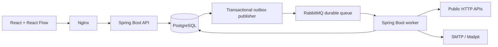

# Architecture and engineering notes

## Components

The API and worker share a JAR and run as separate Compose services. Spring JDBC makes transaction boundaries and PostgreSQL lease queries explicit. A JPA abstraction would add little to the small relational persistence layer here. Workflow definitions and outputs use JSONB; ownership, versioning, status and scheduling metadata remain relational.

## Request and execution lifecycle

1. Session authentication resolves a user from a hashed opaque token. All private record queries include owner ID.
2. Saves validate the graph and credential ownership, lock the workflow row and verify its version. The new definition is stored in `workflow_versions`.
3. Manual, webhook, form and schedule triggers insert an execution snapshot, step records and outbox record in one transaction.
4. The publisher sends a persistent RabbitMQ message and waits for a broker confirmation before deleting the outbox row. Publishing more than once after a crash is allowed.
5. A worker claims the run using an atomic conditional UPDATE with a 90-second lease. Duplicate deliveries cannot claim a currently leased execution.
6. It chooses one dependency-ready step. Previously committed steps are never normally repeated. Conditions choose active edges; unselected branches are marked skipped.
7. Results are recorded, the lease released, and another message queued. A database poller finds delayed retries and expired leases.
8. A run finishes when every step has succeeded, been skipped or explicitly recovered, a terminal error occurs, or cancellation is observed.

## Guarantees and limits

- Trigger deduplication is enforced by `(workflow_id, dedupe_key)` uniqueness. Reusing a key with different input or trigger returns HTTP 409.
- A workflow edit does not change the definition of an existing execution. Replay uses that original snapshot.
- Step execution is at-least-once across crashes. A receiver's idempotency contract determines whether an external effect repeats.
- Failed transient HTTP statuses (429 and 5xx), transport failures and SMTP failures retry with exponential delays: default 2s/4s and three attempts, configurable 1–5 attempts and 1–60s initial delay. Permanent errors can stop, continue with an error output, or activate an error handle.
- Local pure transformations and condition checks are deterministic for fixed input and snapshot.
- Multiple ready branches execute sequentially within a run. A wait pauses that run; children can progress independently. Joins wait for terminal upstream steps and require at least one active incoming edge. Cycles are rejected.
- HTTP redirects are disabled to avoid bypassing destination checks; requests and responses are bounded to 64 KB. Input/workflow JSON is also bounded. Nginx limits whole requests to 256 KB.
- Broker downtime does not lose committed executions; the worker poller can still discover them. Native development uses database polling; RabbitMQ transport requires the Docker deployment mode.
- One scheduler per API instance polls due rows with row locks; duplicate scheduler processes recheck due time under the lock.

## Security

BCrypt passwords; random session tokens stored as SHA-256 hashes; HttpOnly SameSite=Strict cookies; custom header required on private API mutations; same-origin frontend with no CORS allowance. Production TLS requires `COOKIE_SECURE=true`.

Integration tokens are encrypted with random 96-bit nonces and AES-256-GCM. Token values are never included in credential API responses. Before step outputs/errors are committed, known token values are redacted. Removing a credential can break pending historical runs; deleting credentials is explicit in the UI. Input and workflow configuration are user-visible, so keep secrets in the credential store.

HTTP destination validation rejects loopback, private, link-local, multicast and unique-local IPv6 addresses, embedded URL credentials and nonstandard ports. DNS rebinding needs an infrastructure-level solution before this is exposed publicly. Built-in SMTP uses deployment settings, not user-controlled SMTP hosts.

## Version 0.2: durable control flow and Impact Lab

`steps.state` persists delay deadlines and child execution IDs. A WAITING run releases its lease and sets its next due time; polling it does not increment action attempts. Decisions live in an ownership-checked approvals table. Approval decisions are single-use, and the decision transaction wakes the execution through the outbox. The poller can also discover the updated due time.

Child creation, deduplication, parent/root linking and the parent's child-ID state are committed in one transaction. Children snapshot the selected workflow at spawn time; the parent does not recursively pin future child definitions at enqueue time. Loops create at most 20 children per step and permit five nested levels. Child identity is unique per parent/node/index. Completed children are retained on Resume, which recursively resets unfinished work; a live child lease blocks resume to avoid racing an in-flight action. Cancellation/failure wakes descendants for cancellation; an already-dispatched effect can finish.

Each HTTP/AI, email or table-write attempt first reserves an action against the root execution using an atomic conditional UPDATE and inserts an effect ledger row in the same transaction. The guard spans concurrent children, retries and manual resumes. Reservations remain consumed when a send fails or the process crashes. They measure attempted actions rather than successful deliveries or currency. Root hostname policy also applies to descendants; public/private destination validation remains active. Table reads do not consume the action budget. UI record edits are direct authenticated CRUD, outside workflow budgets.

Impact Lab uses a separate interpreter with access to stored workflow definitions, pure actions and fixtures. It never calls `Actions`, the email sender, data-table writes or execution enqueue. It evaluates the same branching rules, bounds loops/depth/work, marks unknown responses as NEEDS_MOCK, and lists preview assumptions. A same-input version comparison reports changed outputs and action plans. Delay/approval/table-write results are explicit simulations; fixtures do not prove remote behavior. Nested simulation reads current child definitions; it does not reproduce historical child snapshots.

`V2__automation_core.sql` adds tables/columns/indexes without replacing V1 data. Existing run definitions remain untouched; old runs have no retroactive action history. Folder/tag metadata is stored with the versioned JSON definition. Archive is reversible and keeps execution history.

## Source map

- `backend/.../Graph.java`: graph and action configuration validation.
- `Store.java`: ownership-aware queries, snapshots, deduplication and encryption integration.
- `Engine.java`: lease claim, readiness, branching, retries and recovery.
- `Actions.java`, `LimitedBody.java`: bounded HTTP/AI and SMTP transport; `PureActions.java`, `Templates.java`: deterministic operations and typed data substitution.
- `DurableSteps.java`: waits, decisions and nested runs; `EffectGuard.java`: atomic root budget and hostname policy.
- `ImpactLab.java`: simulation and same-input version comparison; `DataService.java`: private keyed records.
- `WorkspaceController.java`, `FormController.java`: versions, recovery, approvals, tables and typed public forms.
- `Dispatch.java`, `Schedules.java`: queue/outbox, interval/cron scheduling and worker recovery.
- `Security.java`, `AuthController.java`, `Secrets.java`: authentication and credential cryptography.
- `frontend/src/Editor.tsx`: React Flow canvas and node inspector.
- `frontend/src/App.tsx`: workspace, templates, credentials and execution detail.
- `frontend/src/Workbench.tsx`, `AdvancedConfig.tsx`, `ImpactPanel.tsx`: new management views, step inspectors and Impact Lab/version UI.
