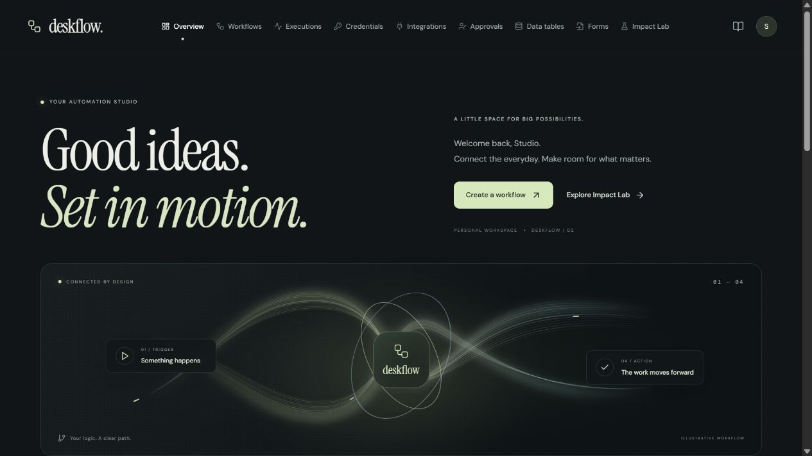
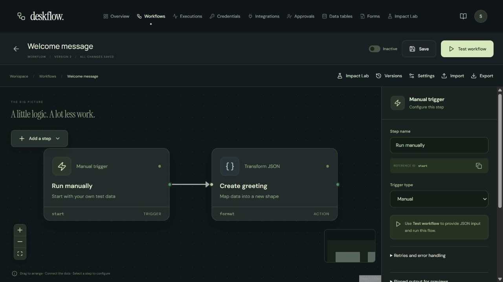

# DeskFlow

[](https://github.com/Kojizz/deskflow/actions/workflows/ci.yml)

A visual workflow automation platform built with **Java 21, Spring Boot, PostgreSQL, RabbitMQ, React and TypeScript**. Connect triggers and actions, run workflows, and inspect every execution.



## Features

- Visual workflow editor with 20 step types, six starter templates and import/export.
- Manual, webhook, form and scheduled triggers, including cron expressions and time zones.
- Conditions, filters, switch paths, joins, JSON mapping, formatters and collection operations.
- Durable delays, human approvals, reusable subworkflows and bounded loops.
- HTTP requests, SMTP email, workspace data tables and compatible AI text actions.
- Execution history, retries, cancellation, replay, resume and immutable workflow versions.
- **Impact Lab:** preview planned actions, compare versions using the same input and enforce a shared live action budget.
- Private workspaces, hashed sessions, BCrypt passwords and encrypted bearer credentials.
- Responsive dark interface with top navigation and reduced-motion support.

Slack and GitHub integrations are editable API recipes that require your own credentials. AI actions require a provider endpoint and model. No paid service is connected automatically.

## Stack

| Layer | Technology |
| --- | --- |
| Backend | Java 21, Spring Boot, Spring JDBC, Spring Security |
| Persistence | PostgreSQL 17, JSONB, Flyway |
| Execution | RabbitMQ, transactional outbox, database leases and recovery polling |
| Frontend | React 19, TypeScript, Vite, React Flow |
| Development | Docker Compose, Mailpit, Maven, Vitest, GitHub Actions |

## Run with Docker

Install Docker Desktop and enable its Linux engine. From the repository root in PowerShell:

```powershell
.\scripts\setup.ps1
docker compose up --build -d
```

- App: http://localhost:8088
- Local email inbox: http://localhost:8025
- API documentation: http://localhost:8088/swagger-ui/index.html

Create an account in the app, then create a workflow from a starter template. Setup generates database and broker passwords plus an encryption key in ignored `.env`. Retain this key to keep saved credentials readable. PostgreSQL and RabbitMQ data persist in Docker volumes.

Stop with `docker compose down`. Adding `--volumes` erases the stored database and queue.

## Native Windows development

Requirements: Java 21+, Node 22+ and PostgreSQL 17. The launcher downloads official Maven and Mailpit binaries when needed.

```powershell
.\scripts\start-local.ps1
# App: http://127.0.0.1:5173
# API: http://127.0.0.1:18080

# Stop launcher-managed services; retain database files:
.\scripts\stop-local.ps1
```

Native mode uses an isolated PostgreSQL cluster on `127.0.0.1:55432` and database polling instead of RabbitMQ. Existing project services are reused; unrelated processes are never replaced. Use `-PostgresBin` to select another PostgreSQL installation.

For IntelliJ IDEA, import `backend/pom.xml`. After initial setup, use **Application** or **DeskFlow Local**. Both select the `local` Spring profile and prepare dependencies before startup. The preparation task releases a recorded launcher-owned API so IntelliJ can own port 18080.

To prepare dependencies manually without starting a second backend:

```powershell
.\scripts\prepare-intellij.ps1 -SkipBuild
# Then use IntelliJ Run.
```

For frontend development after dependencies are ready:

```powershell
cd frontend
npm ci
npm run dev
```

`npm run build` creates the production frontend bundle. `npm run dev` starts the development server.

## Try a workflow

1. Create the **Welcome message** starter.
2. Select a step to inspect its configuration.
3. Choose **Test workflow** and submit the sample input.
4. Open **Executions** to inspect each step and its output.
5. Use **Impact Lab** to preview a change before running it.



See [the feature guide](FEATURE_GUIDE.md) for approvals, forms, tables, nested workflows and recovery. [Architecture notes](ARCHITECTURE.md) explain transaction boundaries and execution guarantees.

## Tests

```powershell
cd backend
mvn verify

cd ../frontend
npm ci
npm test
npm run build

cd ..
node scripts/smoke.mjs http://127.0.0.1:5173
node scripts/smoke-core.mjs http://127.0.0.1:5173
```

Integration tests use a disposable PostgreSQL 17 container through Testcontainers. A separate disposable database can also be supplied using `TEST_DATABASE_URL`, `TEST_DATABASE_USER` and `TEST_DATABASE_PASSWORD`. Never use a database containing real user data for tests. Live smoke scripts create their own fixture workspaces.

## Project layout

```text
backend/       Spring Boot API, workflow engine, migrations and tests
frontend/      React workspace and visual editor
scripts/       Local startup, setup and API smoke checks
.run/          Shared IntelliJ run configurations
.github/       Build and test workflows
```

## Engineering boundaries

External effects are at-least-once: recovery or replay can repeat a request or email. HTTP actions supply a stable per-step idempotency key; the receiving service must honor it. Cancellation does not undo completed effects.

Impact Lab simulations use explicit fixtures for external reads. They dispatch no HTTP requests, email or table writes, and do not prove a remote provider's behavior. Live action budgets count attempts across retries and nested workflows rather than currency.

This portfolio release has private user workspaces and a bounded execution engine. Team sharing, OAuth app registration, arbitrary-code execution and enterprise SSO are outside its scope. Public deployment requires TLS, secure cookies, network egress isolation, quotas, backups and monitoring. Keep secrets in the credential store, not workflow input or configuration.
